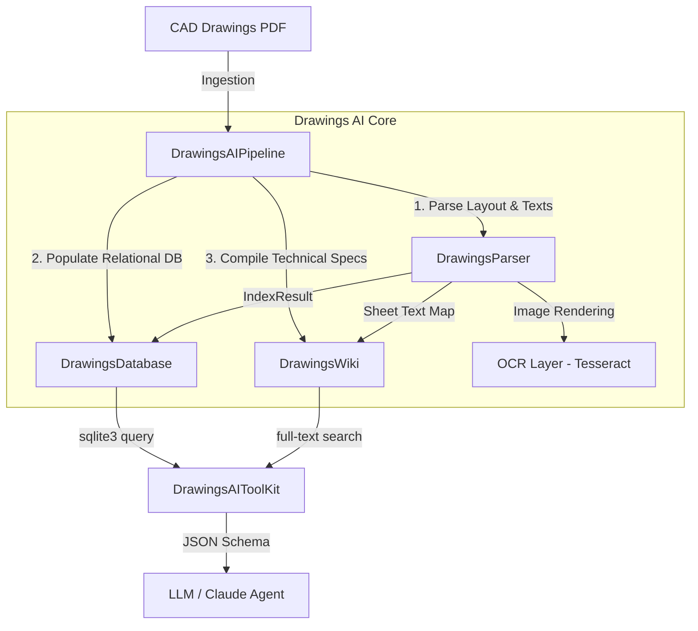

# Drawings AI: System Architecture

Drawings AI is a data-engineering pipeline designed to reverse-engineer 2D CAD and PDF construction drawings into queryable text assets, optimizing token consumption and retrieval accuracy for LLMs.

## Architectural Diagram

## Module Descriptions

### 1. Extensible Parser (`parser.py`)
Responsible for reading PDF files. It uses **PyMuPDF** (`fitz`) to extract the text and graphics coordinate layers.
*   **OCR Integration**: If pages are textless (scanned raster sheets) and OCR is enabled, it renders pages as images using PyMuPDF and transcribes them using **Tesseract OCR**.
*   **Extensible Rule Engine**: Supports registering custom regular expression rules at runtime, allowing trade-specific parsing (e.g. data center battery cabinets or electrical switches) without code alterations.

### 2. Relational Database (`database.py`)
Persists parsed drawing sheets and extracted entities into structured SQLite tables.
*   **Multi-Drawing Aggregation**: Includes an `append` flag. When set, it inserts or replaces records rather than clearing tables, allowing complete projects to be index-aggregated.
*   **SQL Injection Guard**: Intercepts and blocks modification queries (DROP, INSERT, UPDATE, DELETE) to guarantee read-only database query safety for autonomous LLM tools.

### 3. Wiki Compiler (`wiki.py`)
Slices unstructured text notes from drawings, categorizes them by trade (concrete, electrical, structural, general notes), and compiles them into clean, compact Markdown files. Creates a master index file `drawings.md` referencing all registered sheets and specifications.

### 4. LLM Toolkit (`llm_tool.py`)
Exposes OpenAI Tool Calling and Anthropic Claude Tools JSON schemas, enabling LLMs to query the database and search the technical wiki at minimal token costs.
